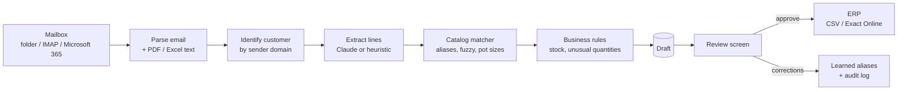

# OrderDesk

OrderDesk turns customer order emails into draft sales orders. It reads the email and its
attachments (PDF, Excel), recognises the customer, matches every item to the catalog, checks
stock, and puts a draft in front of a person. Nothing reaches the ERP until they approve it.

Built for small and mid-sized wholesalers whose order desk retypes emails into the ERP all day.
The sample data is a fictional plant wholesaler (GreenLine Plants) with customers writing in
Dutch, English, German and French.

## Status

This is an MVP that runs end to end. Honest overview:

| Part | State |
|---|---|
| Email parsing, PDF and Excel attachments | Working |
| Extraction with Claude (structured tool output) | Working, needs an API key |
| Offline heuristic extractor | Working, tidy lists only (baseline) |
| Catalog matching, customer aliases, stock and quantity rules | Working, tested |
| Review screen with source highlighting, approve flow | Working |
| Shadow test (`orderdesk evaluate`) | Working |
| Alias learning from reviewer corrections | Working |
| Mail sources: folder, IMAP | Working |
| Mail source: Microsoft 365 (Graph) | Written, not yet tested against a real tenant |
| ERP: CSV export | Working |
| ERP: Exact Online | Skeleton, needs OAuth and testing in a sandbox division |
| Multi-tenant hosting, Postgres, large catalogs | Not started (see roadmap) |

## Quickstart (offline, no API key)

```bash
python -m venv .venv && source .venv/bin/activate
pip install -e ".[dev]"
cp .env.example .env

orderdesk init --reset          # create the database and load data/sample/*.csv
orderdesk ingest                # read the sample .eml files
orderdesk draft --extractor heuristic
orderdesk serve                 # open http://127.0.0.1:8000
```

The heuristic extractor gets the tidy emails right and misses the vague ones ("repeat last
week's order but double the salvias"). That gap is the point of the product.

## With Claude

Put your key in `.env` (`ANTHROPIC_API_KEY=...`), then:

```bash
orderdesk init --reset && orderdesk ingest
orderdesk draft                 # uses ORDERDESK_EXTRACTOR=claude
orderdesk evaluate --truth data/sample/ground_truth.json
```

Compare with `orderdesk evaluate --truth data/sample/ground_truth.json --extractor heuristic`.

## How it works



Design rules that make this safe to sell:

1. **A person approves every order.** The system drafts; it never sends.
2. **The model never has the final word on product codes.** Codes it invents are dropped,
   customer aliases always win, and a match whose catalog name looks nothing like what the
   customer wrote goes to review, even when the model was confident.
3. **Rules only make lines stricter.** Stock and quantity checks can flag a line, never clear one.
4. **Only the sender's own data goes into the prompt** when the sender is known.
5. **Every correction is logged.** That is how accuracy is measured and how the system learns
   each customer's wording.

## Project layout

```
src/orderdesk/
  parsing/        email + attachment text
  extraction/     Claude extractor, heuristic extractor, prompt
  matching/       normalisation, pot sizes, catalog matcher
  rules.py        stock and quantity checks
  pipeline.py     email -> proposal -> saved draft
  review.py       edit lines, approve, learn aliases
  ingest/         folder, IMAP, Microsoft Graph
  erp/            CSV export, Exact Online skeleton
  evaluate.py     shadow test
  api/app.py      FastAPI routes + review screen
  web/            review screen (plain HTML/JS, no build step)
data/sample/      fictional catalog, customers, history, emails, ground truth
data/templates/   empty CSVs for a client's data export
docs/             architecture and client playbook
tests/            pytest suite (runs offline)
```

## Commands

| Command | What it does |
|---|---|
| `orderdesk init [--data DIR] [--reset]` | Create tables, load master data CSVs |
| `orderdesk ingest [--source folder\|imap\|graph]` | Fetch new emails |
| `orderdesk draft [--extractor claude\|heuristic]` | Draft all new emails |
| `orderdesk serve [--host --port --reload]` | Review screen + API on port 8000 |
| `orderdesk worker [--every N] [--once]` | Poll the mailbox and draft continuously |
| `orderdesk evaluate --truth FILE` | Shadow test against known correct orders |

All settings live in `.env` (see `.env.example`). Set `ORDERDESK_UI_USER` and
`ORDERDESK_UI_PASSWORD` before exposing the review screen anywhere but localhost.

## Running for a client

```bash
cp .env.example .env            # fill in mailbox, ERP, API key, UI password
docker compose up -d --build    # web on :8000 + worker polling the mailbox
docker compose run --rm web orderdesk init --data client_data
```

Put the client's exports in `client_data/` (ignored by git) using the formats in
`data/templates/`. The full onboarding process is in [docs/client-playbook.md](docs/client-playbook.md).

## Development

```bash
make test        # pytest
make lint        # ruff
make eval        # shadow test with Claude
make eval-offline
python scripts/make_sample_emails.py   # regenerate sample emails + ground truth
```

CI (GitHub Actions) runs lint, tests and the offline shadow test on every push.

## Roadmap

1. **Large catalogs.** Clients with thousands of articles: retrieve the top candidates per line
   with the fuzzy matcher first, and send only those to the model.
2. **Exact Online for real.** OAuth with token refresh, Item/Account ID import, sandbox tests.
   Then AFAS and other ERPs common in Dutch wholesale.
3. **Microsoft Graph webhooks** instead of polling.
4. **Postgres and one deployment per client**, then a proper multi-tenant setup.
5. **Same engine, next product:** quote requests in, draft quotes out.

## License

Proprietary. All rights reserved.
